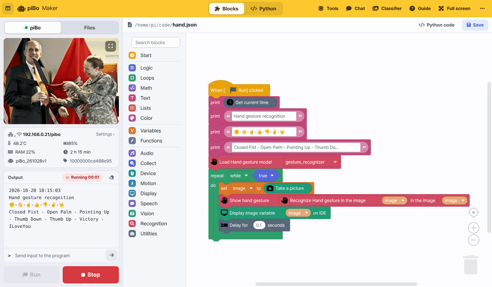
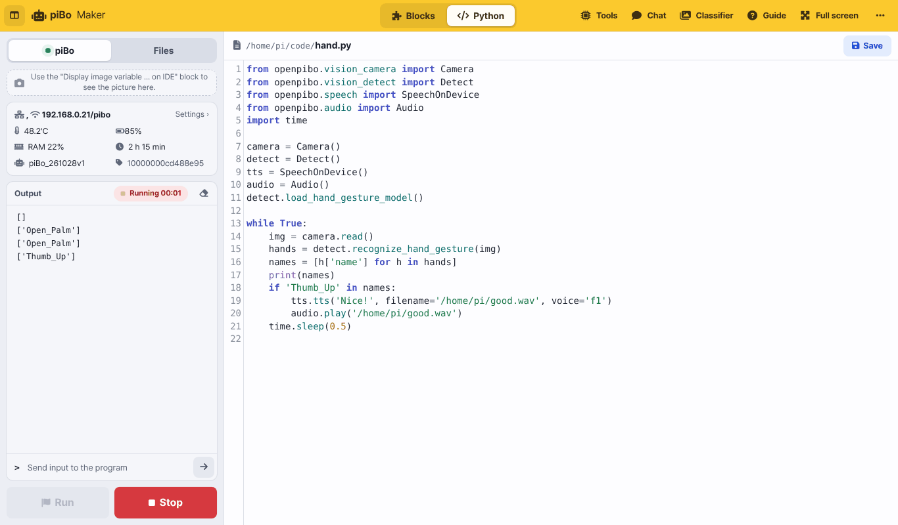
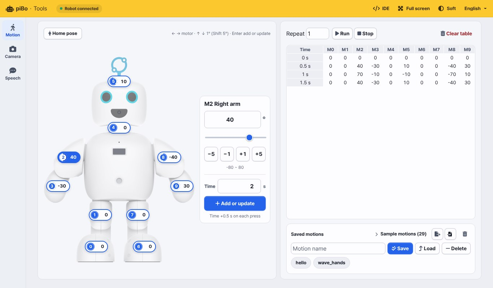
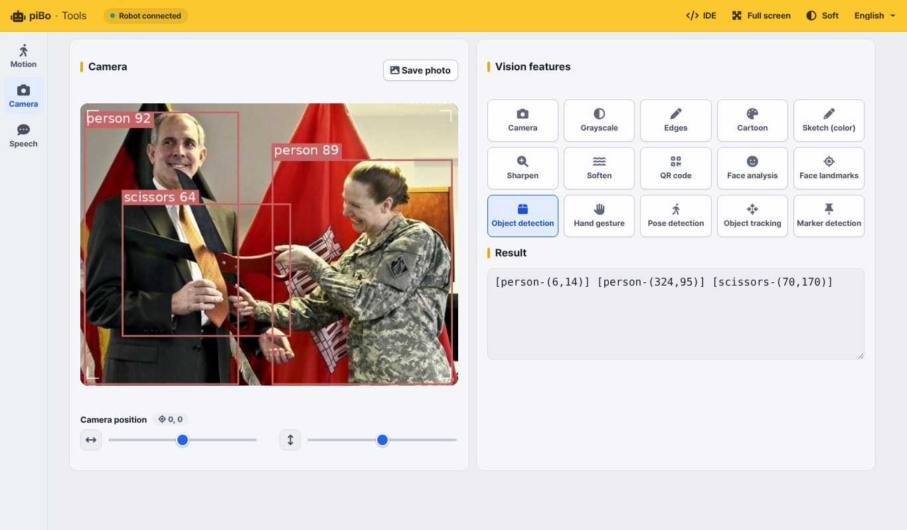
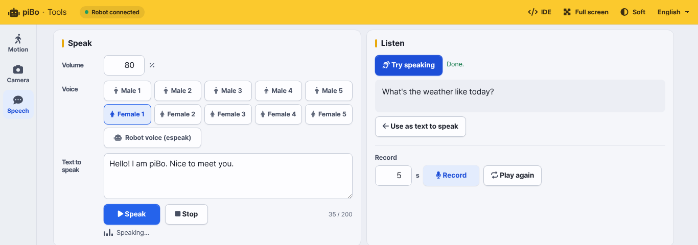
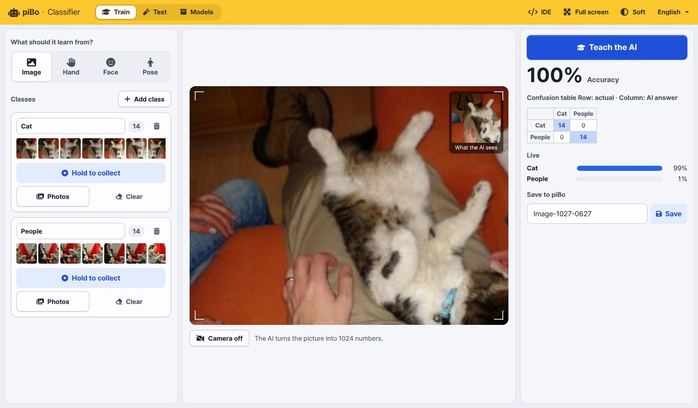

# piBo Maker

piBo Maker is the piBo development environment you open in a web browser. When your tablet or laptop is on the same WiFi
as piBo, type **piBo's IP address** (shown on piBo's screen) into the address bar. There is nothing to install.

| Screen | What it does | Where to open it |
|---|---|---|
| **IDE** | Build and run programs with blocks or Python | `http://<piBo IP>` |
| **Tools** | Try the motors, camera and voice right away, without code | [Tools] at the top of the IDE |
| **Chat** | Chat in text with the language model (LLM) running inside piBo | [Chat] at the top of the IDE |
| **Classifier** | Collect examples with the camera and teach your own AI | [Classifier] at the top of the IDE |
| **Guide** | This document | [Guide] at the top of the IDE |

```{note}
Everything runs **inside piBo** (voices, speech recognition, chat and the classifier included). Only the blocks in the
[Collect] category (Wikipedia, weather, news) need the internet, and that category is only in the Korean edition.
```

## IDE



- **Top bar**: switch the editor with [Blocks | Python]. On the right are Tools, Chat, Classifier, Guide, Full screen and [⋯] More
  (brightness · font size · Python editor theme · language · factory reset · power off · source code and license)
- **Left panel**: **[Run] [Stop]** at the bottom are always visible.
  - [piBo] — screen output (pictures sent with the `Display image variable … on IDE` block), status (WiFi settings, temperature, battery, memory, uptime, version), program output, sending input to the program
  - [Files] — the file list, new file / new folder / upload, and a preview for pictures and sounds
- **Blocks**: drag blocks out of the categories on the left. Type a word such as "sound" or "face" into **Search blocks** at the top
  to find blocks. [Python code] shows the Python code your blocks make. See **Blocks** on the left for every block.



- **Python**: the `openpibo` package gives you every piBo feature. `print` goes to [Output] on the left and `input` reads from the input box.
  See **Python** on the left for the API
- Programs run inside piBo. Press [Stop] to stop one

## Tools

Try piBo's features one at a time, without code. Pick [Motion], [Camera] or [Speech] on the left.



- **Motion**: tap a number on the photo to pick a motor, set its angle in the panel next to it and press **[Add or update]** to add a row
  to the table on the right (the time goes up by 0.5 s each time). [Run] plays the table; type a name and press **[Save]**
  to use it later with the `Run my motion … times` block. On a laptop: ←→ picks the motor, ↑↓ changes the angle, Enter adds or updates



- **Camera**: apply vision features (grayscale, edges, cartoon, QR code, face analysis, object detection, hand gestures, pose, markers…)
  to piBo's camera view. The result also appears as text under [Result]



- **Speech**: pick one of ten voices (Male 1–5, Female 1–5) or the robot voice (espeak) and let piBo say your text. Korean and English are
  detected automatically. [Speak] says it. Under [Listen], press [Try speaking] and talk: piBo stops by itself when you finish and shows
  what it heard as text (up to 10 seconds, processed on piBo). [Use as text to speak] puts that text into the box on the left so piBo can say it back.
  The first time takes a few seconds while speech recognition loads. [Record] records piBo's microphone and [Play again] plays it back

## Classifier



Collect examples with the camera and teach the AI, for example "this is a cat, this is food".

1. **What should it learn from?** — Image (the whole picture) · Hand (hand shape) · Face (expression) · Pose (body posture)
2. Name each **class** and keep pressing **[Hold to collect]** to collect examples. You can also upload files with [Photos]
3. **[Teach the AI]** — the tablet or laptop browser learns in a few seconds and shows the accuracy, a confusion table and live scores
4. **[Save]** (under Save to piBo) — saved on piBo in `/home/pi/mymodel/<model name>`
5. In the IDE use `Load classifier model (mymodel) (model name)` → `Classify (image) with classifier model`.
   `Draw what the classifier saw on image` draws the hand, face or body points and the class name on the picture

The [Test] tab tries a saved model again. [Models] lets you test, keep training, rename, download (zip) or delete a model.

```{tip}
The classifier downloads its AI files (about 10 MB) the first time it opens. Open it once on every tablet before class and it
will start right away during class.
```

## Chat

Chat in text with the language model (LLM) that runs inside piBo. Choose a model in **[Chat model]** at the top, and the model loads then
(the first time takes several tens of seconds). Changing the model starts the chat over.

| Model | What it is |
|---|---|
| General | Chats in Korean and English. No tools |
| TheMaker KO | A Korean model trained to talk with students. You can ask piBo to do things (tools below) |
| TheMaker EN | The English version of TheMaker. If the model file is not on the robot, it shows "(not installed)" and can't be chosen |

TheMaker listens and **chooses a tool by itself**. The tool it ran appears in small text under the answer (for example `Light red`).

| Tool | Try saying | What it does |
|---|---|---|
| Light | "Turn on the red light", "Turn off the light" | Changes or turns off the eye light (red, orange, yellow, green, blue, sky blue, purple, pink, white) |
| Look | "What do you see?" | Looks with the camera and says what it sees |
| Move | "Say hello", "Can you dance?" | greeting, wave, dance, clap, high five, nod, head shake, forward, backward, left, right |

- Say **"Stop"** and it stops right away, without asking the model.
- Moves that change place (forward, backward, left, right) happen only when your words name a direction. Be careful near the edge of a desk.
- Say "Let's just talk" to stop using tools, and "You can move now" to use them again.
- Turn on [Speak out loud] and piBo speaks the answer (you can choose the voice and volume).

Programs can use it too, with the `Choose chat model`, `Start LLM server` and `Respond to …` blocks in [Speech].
Blocks chat in text only and do not run tools.

```{note}
Tools, Chat and Classifier run **one at a time**. Opening one closes the others, and running a program in the IDE closes them too
(they share the camera, speaker and memory). A closed screen shows [Restart].
```
